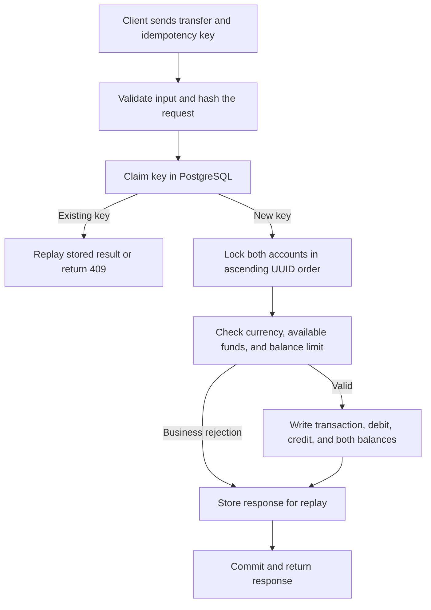

# PayLedger

PayLedger is a local payments API for simulated funding and transfers. It records both sides of every movement and keeps account balances correct when requests overlap, clients retry, or posting fails halfway. The project uses FastAPI, synchronous SQLAlchemy 2.0, psycopg 3, and PostgreSQL 16.

## Run the API

With Docker and Compose installed, run this from the project directory.

```sh
docker compose up --build -d
```

The API listens on loopback. Open [Swagger UI](http://127.0.0.1:8000/docs) to try the five endpoints. PostgreSQL runs on host port 55436, and its data lives in a named volume. Startup creates the schema and seeds one internal funding account for each currency.

For local development, use Python 3.12 and install the dependencies. You can run just PostgreSQL with `docker compose up -d db`. For an existing PostgreSQL 16 server, create a dedicated `payledger` database and set `DATABASE_URL` to its `postgresql+psycopg://` connection string.

**macOS and Linux**

```sh
python3 -m venv .venv
.venv/bin/python -m pip install -r requirements.txt
.venv/bin/python -m uvicorn app.main:app --host 127.0.0.1 --port 8000
```

**Windows PowerShell**

```powershell
py -3.12 -m venv .venv
.\.venv\Scripts\python.exe -m pip install -r requirements.txt
.\.venv\Scripts\python.exe -m uvicorn app.main:app --host 127.0.0.1 --port 8000
```

## Demo

From the project directory, with the API running, use the command for your platform.

**macOS and Linux**

```sh
.venv/bin/python demo.py
```

**Windows PowerShell**

```powershell
.\.venv\Scripts\python.exe demo.py
```

The demo creates a student and university account, deposits ₹1,000, transfers ₹800, and replays the transfer. It checks for the same response body and the `Idempotent-Replay: true` header. The student ends with ₹200 and the university with ₹800. The student's history has one debit for the transfer and one credit for the deposit.

| Endpoint | Inputs |
| --- | --- |
| `POST /accounts` | `owner`, `currency` |
| `POST /deposits` | `account_id`, `amount_cents`, and an `Idempotency-Key` header |
| `POST /transfers` | `sender_id`, `receiver_id`, `amount_cents`, and an `Idempotency-Key` header |
| `GET /accounts/{id}` | Account UUID |
| `GET /accounts/{id}/transactions` | Optional `limit` and opaque `cursor` |

## How a transfer commits



- **Money and accounting.** Amounts are integer minor units in `BIGINT`. For INR, `100000` means ₹1,000 in paise. Accepted amounts are 1 to 10¹², and customer balances are capped at 10¹⁵. A deposit credits the customer and debits the internal funding account in the same currency. A transfer debits the sender and credits the receiver. Balance changes and ledger entries commit together.
- **Competing transfers.** PostgreSQL uses `READ COMMITTED`. Each operation locks both accounts in ascending UUID order, then reads the current balances. A second request against the same sender waits and sees the updated balance. The shared ordering prevents a cycle between operations that lock the same two accounts in opposite directions.
- **Retries and failures.** The unique key decides which request may execute. A retry with the same validated body gets the saved status and body, including for business rejections. A different body or endpoint gets `409`. A fresh attempt after adding funds requires a new key. An unexpected failure rolls back the posting and key claim, so retrying the same key can execute again.
- **History.** Each account shows its own side of a posting. PostgreSQL assigns `created_at` with `clock_timestamp()` when the ledger transaction row is inserted, after the account locks are acquired. The cursor sorts by that timestamp and uses the transaction UUID to break ties. [PostgreSQL date and time functions](https://www.postgresql.org/docs/16/functions-datetime.html#FUNCTIONS-DATETIME-CURRENT)

## Run the tests

Create the dedicated test database once if running the Compose database.

```sh
docker compose exec db createdb -U payledger payledger_test
```

For a native PostgreSQL instance, create `payledger_test` and set `TEST_DATABASE_URL` to its connection string. The database role must be able to create schemas. Tests create and remove their own isolated schemas and exercise a real Uvicorn server with HTTPX.

**macOS and Linux**

```sh
.venv/bin/python -m pytest -q
.venv/bin/python -m pytest -q tests/test_concurrency.py tests/test_rollback.py
```

**Windows PowerShell**

```powershell
.\.venv\Scripts\python.exe -m pytest -q
.\.venv\Scripts\python.exe -m pytest -q tests/test_concurrency.py tests/test_rollback.py
```

The headline tests cover 50 competing transfers, ten concurrent requests with the same key, and an injected failure after the debit was flushed. The rest cover opposite-direction transfers, reconciliation of every account balance against its entries, validation, and pagination.

## Known limitations

- Keys are globally unique and have no expiry. A production API would scope them per client and define an expiry policy.
- The API is unauthenticated and intended for loopback use. Deposits simulate funding.
- Each currency's funding account serializes deposits on one row. Separate funding accounts or batching would reduce that contention.
- v1 supports INR, USD, and GBP without conversion. Refunds, reversals, and multi-instance deployment are outside the demo.
- History pages are live reads. Because `created_at` records insertion time, a row that commits after the client has paged past its timestamp can be missed until history is refreshed.
